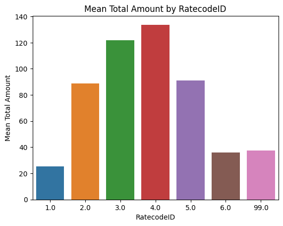
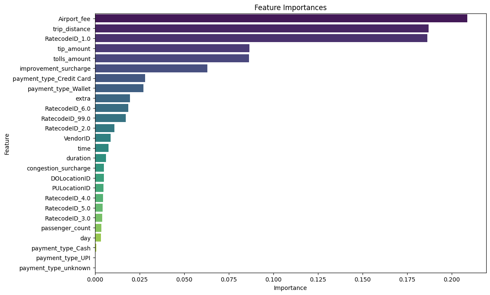

# Taxi Fare Prediction

Predicting the **total amount paid for a taxi trip** from trip, rate and surcharge details.
Built for a private in-class Kaggle competition of the *Machine Learning Practice* course, IIT Madras BS in Data Science.

**Result: 5th out of 714 participants, and awarded Best Project in Machine Learning Practice.**

| | |
|---|---|
| Task | Regression (target: `total_amount`) |
| Competition metric | R² score |
| Data | 175,000 training trips and 50,000 test trips (competition dataset provided by the course) |
| Best single model (validation) | XGBoost, R² 0.951 |
| Segment-wise blend (validation) | R² **0.954** |

## Approach

### 1. Exploration and hypotheses
- **Missing values come together.** 6,077 rows are missing `passenger_count`, `RatecodeID`, `store_and_fwd_flag`, `congestion_surcharge` and `Airport_fee` at the same time. These were treated as a separate group: `RatecodeID` = 6 (a new category), `passenger_count` = -1, and the two fees = 0.
- **RatecodeID matters a lot.** Mean fares differ sharply between rate codes, and code 5 has short trips but high fares, which suggests rate codes reflect vehicle or fare types rather than distance alone.



### 2. Cleaning
- Removed 3 trips with a distance above 10,000 (up to 135,182), which are clearly recording errors.
- Kept the 1,725 trips with a negative total, because the negatives come from fee columns (extra, tolls, surcharges) and can also appear in the test data.
- Swapped pickup and drop-off times for 65,673 trips where pickup was later than drop-off.

### 3. Features
Trip duration (minutes), time of day, and day of week from the pickup timestamp; one-hot encoding of `RatecodeID` and `payment_type`.

### 4. Model comparison (25% hold-out, R²)

| Model | Validation R² |
|---|---|
| Linear Regression (baseline) | 0.760 |
| Gradient Boosting | 0.933 |
| Random Forest | 0.948 |
| Extra Trees | 0.949 |
| XGBoost | 0.951 |

### 5. Error analysis by RatecodeID
Overall scores hid weak segments. Extra Trees scored only **R² 0.66 on RatecodeID 5**, where XGBoost (0.71) and Random Forest (0.71) did better. Blending by segment, averaging XGBoost and Random Forest for RatecodeID 5 and XGBoost and Extra Trees for RatecodeID 6, raised validation R² from **0.949 to 0.954**.

### 6. Final model
Two tuned Extra Trees models (averaged), combined with XGBoost and Random Forest predictions by RatecodeID segment.

## What drives the fare



Airport fee, trip distance and the standard rate code carry the most signal, followed by tips, tolls and surcharges. Passenger count matters very little.

## Repository structure

```
taxi-fare-prediction/
├── notebooks/
│   └── taxi_fare_prediction.ipynb   # full analysis with outputs
├── images/                          # charts used in this README
├── requirements.txt
└── README.md
```

The dataset belonged to a private course competition and is not included. The notebook is provided with all outputs so results can be reviewed without re-running.

## Limitations and next steps

- Pickup and drop-off location IDs are used as plain numbers; treating them as categories (for example with CatBoost) could capture zone-level price differences.
- Extra Trees with default settings fits the training data perfectly (train R² 1.0), so tuning depth and leaf size matters.
- Cross-validation and grid-search cells are commented out to keep the submission run short, so their outputs are not saved in the notebook.
- A column-order slip in the final blending cell means the submitted blend differs from the one validated above. It is documented in the notebook, and the code is kept as submitted.
- `tip_amount` is used as an input because the competition provided it at test time; a real pre-trip fare estimator would not have it.

## Tech stack

Python, pandas, NumPy, scikit-learn, XGBoost, Matplotlib, seaborn
